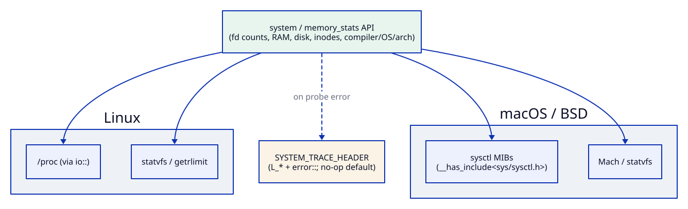

# system

[](https://github.com/Kronuz/system/actions/workflows/ci.yml)
[](LICENSE)


How much is left? File descriptors, RAM, disk, and inodes for the current process
and machine, in C++20, plus the compiler, OS, and architecture it runs on. One call
per number, on Linux, macOS, and FreeBSD.



## ✨ Highlights

- 📂 **File descriptors**: open and maximum, per process and system-wide.
- 🧠 **Memory**: total RAM, process resident or virtual size, total virtual memory.
- 💽 **Disk**: total and free bytes and inodes of the filesystem holding the
  current directory.
- 🏷️ **Identification**: `check_compiler()`, `check_OS()`, `check_architecture()`.
- 🧩 **Portable**: feature detection with `__has_include`, no generated `config.h`;
  logging is an optional seam (`SYSTEM_TRACE_HEADER`).

## 📦 Installation

Requires a C++20 compiler and CMake 3.14 or newer. It brings
[io](https://github.com/Kronuz/io) and [strings](https://github.com/Kronuz/strings).
CI builds it on Linux (x86_64, arm64), macOS (arm64, x86_64), and FreeBSD, plus ASan,
UBSan, and TSan builds.

```cmake
include(FetchContent)
FetchContent_Declare(system
  GIT_REPOSITORY https://github.com/Kronuz/system.git
  GIT_TAG        main)
FetchContent_MakeAvailable(system)

target_link_libraries(my_app PRIVATE system::system)
```

## 🚀 Quick start

```cpp
#include "memory_stats.h"
#include "system.hh"

#include <cstdio>

int main() {
	std::printf("fds   %zu / %zu\n", get_open_files_per_proc(), get_max_files_per_proc());
	std::printf("rss   %llu of %llu bytes\n",
		(unsigned long long)get_current_memory_by_process(), (unsigned long long)get_total_ram());
	std::printf("disk  %llu free\n", (unsigned long long)get_free_disk_size());
	std::printf("%s on %s (%s)\n", check_compiler().c_str(), check_OS().c_str(), check_architecture().c_str());
}
```

`examples/usage.cc` is a self-checking version that runs under `ctest`.

## 🎯 When to use it

- ✅ Health endpoints, startup banners, and resource limits checks.
- ❌ Per-thread or cgroup-aware accounting: these are process- and machine-wide
  numbers.

## 📚 Documentation

- [ARCHITECTURE.md](ARCHITECTURE.md): where each number comes from on each platform.
- [AGENTS.md](AGENTS.md): repository map and invariants.

## 🛠️ Building and testing

```sh
cmake -B build -DCMAKE_BUILD_TYPE=Release && cmake --build build
ctest --test-dir build
```

## 🤝 Contributing

Issues and pull requests are welcome. Read [AGENTS.md](AGENTS.md) first. CI must
pass on every platform.

## 📄 License

MIT, Copyright (c) 2015-2019 Dubalu LLC. See [LICENSE](LICENSE). Extracted from
[Xapiand](https://github.com/Kronuz/Xapiand).
